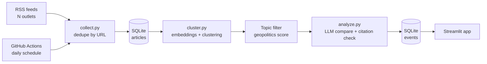

# Geopolitical Event Comparison Pipeline

Finds news reports from different outlets about the **same geopolitical event** and shows what they agree on and where their reports differ. Every statement links back to the source articles.

**Live demo:** [add Streamlit link]
**Stack:** Python, RSS (feedparser), SQLite, sentence-transformers, scikit-learn, Groq LLM, Pydantic, Streamlit, GitHub Actions


> **This is a reading aid, not analysis or advice.** It works from headlines and short snippets only. Always read the original articles.

## The problem

One summit, sanction or border incident is reported by many outlets, each with different details and emphasis. Reading them all is slow, and it is hard to see what is confirmed and what is reported differently.

## What it does

1. Collects headlines and snippets from [N] outlets in different regions through public RSS feeds, every day.
2. Embeds each article and groups articles about the same event with agglomerative clustering.
3. Filters out non-geopolitical clusters (sport, celebrity news) with an embedding-based topic score, at no LLM cost.
4. For each event cluster, asks an LLM for a neutral summary, facts that at least two outlets agree on, and differences between outlets, as validated JSON.
5. Checks the output: citations must point to real articles, and agreed facts must be supported by at least two outlets.
6. Stores everything in SQLite and shows it in a Streamlit app, refreshed by a daily GitHub Actions job.

## Architecture



## Key engineering decisions

- **Clustering with a distance threshold** instead of a fixed number of clusters, because the number of events per day is unknown. The threshold was tuned on hand-labelled pairs (see Evaluation).
- **Topic filter before the LLM.** The feeds cover all world news, so clusters are scored against example geopolitical sentences using embeddings. This removes off-topic clusters without spending API quota.
- **Safe reruns.** Articles are keyed by URL, and each event has a hash key built from its article URLs, so reruns never duplicate data or re-pay for LLM calls on events already analyzed.
- **Constrained LLM output.** The model must use only the provided text, return JSON, and cite article numbers. Pydantic rejects malformed output, and a checker drops citations that point to non-existent articles.
- **Fails visibly.** If every feed fails, the pipeline stops with an error, so a scheduled run shows red instead of silently doing nothing. Each run is logged in a `runs` table.
- **Neutral wording.** The tool reports differences ("Outlet A gives a figure, Outlet B does not"). It never labels an outlet as biased.

## Evaluation

All numbers come from hand-labelled data. [N] is the number of examples.

### 1. Is the clustering right?
[N] article pairs, sampled from pairs that look similar, labelled "same event" or "different event" by me. Rule used: *same event means the same specific real-world development, not just the same topic.*

| Distance threshold | Precision | Recall | F1 |
|---|---|---|---|
| 0.45 (my first guess) | [ ] | [ ] | [ ] |
| [best value] (chosen) | [ ] | [ ] | [ ] |

### 2. Does the topic filter keep geopolitics and drop the rest?
[N] clusters labelled geopolitical or not.

| Minimum topic score | Clusters kept | Precision | Recall |
|---|---|---|---|
| [ ] | [ ] | [ ] | [ ] |
| 0.18 (current) | [ ] | [ ] | [ ] |

### 3. Are the summaries faithful to the sources?
[N] claims (summaries and agreed facts) checked by hand against the cited headline and snippet.

| Verdict | Count |
|---|---|
| Fully supported | [ ] ([ ]%) |
| Partly supported | [ ] |
| Not supported | [ ] |

The citation checker removed [ ] claims across [ ] events because their citations were invalid or had fewer than two outlets.

### What I found
- [Example: an early version added a year to an event title that was not in any headline. I added a rule forbidding details not found in the articles, then re-measured.]
- [Example: low topic thresholds let sport and royalty stories through.]
- [Add one more real finding from your own review.]

## Limitations

- **Headlines and snippets only.** RSS feeds do not give full articles, so the differences that can be found are limited (figures, wording, emphasis in the opening lines).
- **English-language outlets only.**
- **Evaluation sets are small and hand-labelled by one person.** Clustering pairs were sampled from similar-looking pairs, so the scores describe borderline cases and not all pairs.
- **LLM output can still be wrong.** The checks reduce but do not remove this. [X]% of reviewed claims were not fully supported.
- **Free-tier limits.** The LLM runs on a free tier with daily limits, so each run analyzes at most [10] new events.
- **The database file is committed to git** by the daily job. The history will grow over time, and old data is deleted after [14] days to keep it small.
- Feed URLs can change or disappear. The pipeline reports failed feeds in its logs.

## Project structure

```
app.py                  Streamlit app (reads data/events.db)
pipeline.py             Runs the whole pipeline end to end
collect.py              Fetches RSS feeds, stores new articles
cluster.py              Embeddings, clustering, topic filter
analyze.py              LLM comparison, JSON validation, citation checks
db.py                   SQLite schema and connection
config.py               Thresholds and settings
feeds.py                List of RSS feeds
test_feeds.py           Checks which feeds work
data/events.db          SQLite database (updated daily by GitHub Actions)
evaluation/             Labelling and scoring scripts
.github/workflows/      Daily schedule
```

## Run locally

```bash
git clone https://github.com/DivyaKBan/Geopolitical-event-comparison-pipeline.git
cd Geopolitical-event-comparison-pipeline
python -m venv venv
venv\Scripts\activate                 # Windows
pip install -r requirements-pipeline.txt -r requirements.txt
```

Create a `.env` file with a free key from console.groq.com:
```
GROQ_API_KEY=your-key-here
```

Then:
```bash
python test_feeds.py        # check which feeds work
python pipeline.py          # collect, cluster, analyze
streamlit run app.py        # open the app
```
In `config.py`, set a Groq text model that your account lists, for `MODEL_NAME`.

### Run the evaluations
```bash
python -m evaluation.make_pairs            # then label the CSV, then:
python -m evaluation.eval_clustering
python -m evaluation.topic_labels          # then label the CSV, then:
python -m evaluation.eval_topic
python -m evaluation.export_for_review     # then label the CSV, then:
python -m evaluation.score_faithfulness
```

## Data and disclaimer

The project stores only headlines, short snippets and links from public RSS feeds, and links back to the originals. It is a non-commercial learning project and is not affiliated with any outlet. If you are a publisher and want your feed removed, open an issue.

## What I would do next

- Read full articles (where allowed) for deeper comparison.
- Add multilingual embeddings and non-English outlets.
- Add a second LLM pass that checks each claim against its sources.
- Track how an event's coverage changes over several days.
